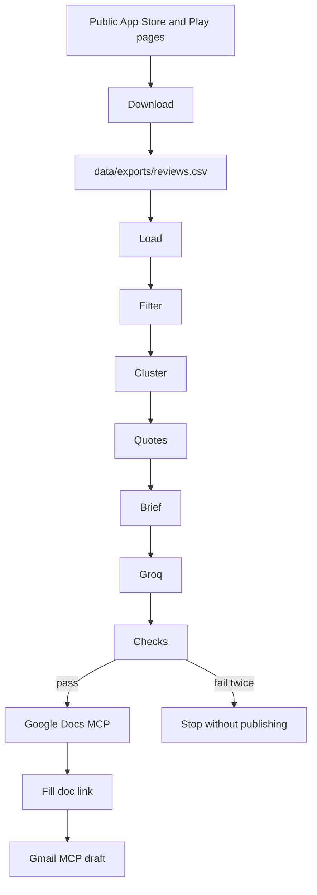

# Architecture: Groww Weekly Review Pulse

**Follows:** [PRD.md](PRD.md). Case-by-case behavior is in [edgecases.md](edgecases.md).  
**Demo shape:** two local Python commands. The first downloads public reviews into `data/exports/reviews.csv`. The second reads that file, builds a brief in code, asks Groq to write the note and the email, then publishes through MCP.  
**Last updated:** 28 September 2026.

## 1. System at a glance

`python -m src.download` fills the export. `python -m src.run` produces the pulse. The download does not log into a store. The run does not fetch, does not send mail, and does not call the Google REST API.



Three boundaries:

1. **Code owns facts.** Loading, the window, theme ranking, counts, and the quote strings are deterministic. The same export and the same window always produce the same brief.
2. **Groq owns wording.** It writes the Doc body and the email from the brief. It does not see the export.
3. **MCP owns delivery.** A Docs tool writes the checked note. A Gmail tool creates a draft. The publisher does not send.

## 2. Components

| Component | Responsibility |
| --- | --- |
| Config | Window, export path, Groq model, operator recipient. Fails the run if the key or the recipient is missing. |
| Downloader | Fetch public App Store and Play pages for the last 12 weeks and write `data/exports/reviews.csv`. |
| Loader | Read that CSV or JSON. Map field aliases. Drop identity columns. Keep `store`, `rating`, `date`, `text`, and `title` when present. |
| Filter | App id, store names, ratings, dates, duplicates, and the 8–12 week window. |
| Catalog | The five theme names, in a fixed order, with the keywords that assign a review. |
| Cluster | One primary theme per review. Rank themes. Keep at most the top three for the note. |
| Quotes | Choose up to three verbatim snippets from highlighted themes. Skip unsafe rows. |
| Brief | The only object passed to Groq. Header facts, highlighted themes, other theme counts, quotes, and shortfall lines. |
| Writer | Groq chat completions. Returns a Doc body, an email subject, and an email body. |
| Checks | Compare the writer output to the brief before any MCP call. |
| Docs publisher | Create or update the pulse through a Google Docs MCP tool. |
| Gmail publisher | Substitute the Doc URL, then create one draft through a Gmail MCP tool. |
| Run notes | Window, counts, model name, Doc URL, and whether the draft was created. No review text. |
| State | Week-ending date to Doc id and URL, so a re-run updates the same Doc. |

Layout the build follows:

```
src/
  download.py            # write data/exports/reviews.csv
  run.py                 # one weekly run, reads the csv
  config.py
  load.py
  filter.py
  catalog.py
  cluster.py
  quotes.py
  artifacts.py           # write catalog/themes/clusters/quotes JSON
  analyze.py             # cluster export → data/pulse/*.json
  brief.py
  writer.py
  checks.py
  publish/
    docs.py
    gmail.py
  notes.py
data/
  exports/
    reviews.csv          # downloaded rows, gitignored
    download_notes.json  # counts only, gitignored
  pulse/
    catalog.json         # theme catalog
    themes.json          # ranked theme stats
    clusters.json        # reviews grouped by theme
    quotes.json          # selected quotes
  state.json             # week → doc id and url
  runs/                  # run notes
```

```bash
python -m src.download
python -m src.analyze --run-date 2026-09-28
python -m src.run --export data/exports/reviews.csv
```
## 3. What crosses each boundary

The export may contain reviewer names and other identity fields. Those columns are dropped in the loader and never leave that step.

The brief is the contract with Groq. It contains:

| Field | Source |
| --- | --- |
| Title, window, run date | Config and the filter |
| Kept count, count by store, missing store, unthemed count, drop counts | Filter and cluster |
| Highlighted themes | Name, review count, average stars to one decimal |
| Other themes | Name and count only, for the one compact line |
| Quotes | The selected string, store, rating, date, and theme. Zero to three items |
| Shortfalls | Why a store, a theme, or a quote is absent |

The brief does not contain raw rows, identity fields, or the operator’s email.

Groq returns three strings: `doc_body`, `email_subject`, and `email_body`. The published Doc is the header rendered from the brief, then `doc_body`. The header is not part of the 250-word count. The email subject must equal the title. `{doc_link}` in the email body is the only placeholder, and it is filled after Docs returns a URL.

Run notes and `state.json` store counts, the model name, the Doc id, and the Doc URL. They do not store review text or the recipient address.

## 4. Download, then load and filter

### 4.1 Download

`src/download.py` writes `data/exports/reviews.csv` for both stores before any clustering. The window matches the filter. Default end date is the run date. Default start date is 84 days earlier (12 weeks). Both ends are inclusive. `PULSE_WINDOW_WEEKS` from 8 to 12 changes both commands together. Eight weeks is 56 days. A run date of 28 September 2026 keeps 6 July 2026 through 28 September 2026.

Columns are `store`, `rating`, `date`, `title`, `text`, `app_id`. Dates are `YYYY-MM-DD`. Reviewer names are dropped before the file is written.

| Store | Requests | Rows kept |
| --- | --- | --- |
| App Store | Public iTunes `userReviewsRow` for India (`X-Apple-Store-Front: 143467`), paginated most-recent. RSS and the see-all product page remain backups when that feed is thin. | `store=app_store`, date inside the window |
| Play | Public Play `batchexecute` reviews RPC `UsvDTd` for India, paginated newest-first, until dates leave the window. The details HTML page remains a backup. | `store=play`, date inside the window |

The RSS loop stops on an empty page or when the newest review on a page is already before the window start. Apple `userReviewsRow` and Play `batchexecute` also stop when a page’s oldest review is before the window start. Reviewer names from either feed are not written to the CSV.

A timeout or HTTP 5xx retries that URL once. One failed source does not drop the other store. If every source URL fails, the previous CSV is left in place. `download_notes.json` records the window, counts by store, how many rows were older than the window, and any empty-feed note. It does not store review text.

### 4.2 Load and filter

The loader accepts the downloaded CSV, or a JSON list with the same fields. A JSON object is accepted only when it has a single list value. Field aliases are `review`, `content`, and `body` for text; `stars` and `score` for rating; `platform` for store. An empty `text` falls back to `title`. Identity columns are discarded here.

The filter then keeps a row only when:

- The store maps to App Store or Play.
- The rating is an integer from 1 to 5.
- The date is ISO-8601 or contains an English month name. Calendar dates are compared, not clock times. A numeric date that could be day/month or month/day stops the run.
- The app id, when the column exists, is `com.nextbillion.groww` or `1404871703`. A file with no app id is treated as an export of this app.
- The calendar date is inside the window, including both ends. The default window ends on the run date and starts 12 weeks earlier.

Duplicates are the same store, calendar date, rating, and text after whitespace is collapsed. The first row wins.

A configured window outside 8–12 weeks stops the run when the export covers at least 8 weeks. A file whose own dates span less than 8 weeks continues, and the header states the actual range. An empty file, a wrong-app file, or a window with zero kept rows does not stop. Those become a brief with no themes, and Groq writes the one-sentence note from [edgecases.md](edgecases.md).

## 5. Themes and quotes

Theme assignment is keyword counting against `catalog.py`. It is not a model call. A review goes to the theme with the most hits in title plus text. A tie uses the earlier theme in the catalog. No hits means unthemed. Stars never assign a theme.

Ranking is review count, then lower average rating, then more recent median date, then earlier catalog order. The note highlights at most three themes. One or two themes stay one or two. The other catalog themes that occurred appear only as a count line.

Quote selection runs after ranking:

1. Skip a review whose title or text contains an email, a phone number, an `@handle`, a PAN-shaped id, or a run of 10 or more digits. The row still counts toward its theme.
2. Skip emoji-only or punctuation-only text.
3. Take at most one quote from each highlighted theme, then fill from the remaining safe reviews in those themes, up to three.
4. Do not quote two reviews that share the same words.
5. Keep at most the first two sentences. A first sentence longer than 40 words is cut to a 40-word prefix plus `...`.

The string saved on the brief, including `...`, is the string the Doc must contain.

## 6. Groq

The writer calls Groq chat completions only. The model is `qwen/qwen3.8-27b` unless `GROQ_MODEL` is set. There is no other chat provider and no fallback prose.

The prompt carries the brief and the writing rules from PRD sections 8 and 9: one sentence per highlighted theme, the quote strings copied unchanged, one action per highlighted theme, no extra theme, no new number, no investment advice, body at or under 250 words. When the brief has no themes, the prompt asks for the header sentence only.

A transport timeout, HTTP 429, or HTTP 5xx retries the call once. Any other HTTP error stops the run. A missing `GROQ_API_KEY` stops the run before this call.

## 7. Checks

Checks run on the writer output before Docs or Gmail. One failure returns the failed rule names to Groq for a single second draft. A second failure stops the run. The failed text is not published and is not replaced with hand-written copy.

| Check | Pass condition |
| --- | --- |
| Shape | Doc body, subject, and email body are present. One wrapping code fence is stripped first. |
| Quotes | Each brief quote appears in the Doc body unchanged. No quote is added when the brief has none. |
| Facts | Highlighted theme names and counts match the brief. |
| Actions | One action per highlighted theme, and none when there are no themes. |
| Length | Doc body is 250 words or fewer, excluding the code-rendered header. |
| Privacy | No email, phone, `@handle`, PAN-shaped id, or 10-digit run in the Doc body or the email. |
| Advice | No buy, sell, hold, or scheme recommendation. |
| Subject | Email subject equals the title from the brief. |
| Link slot | The email contains the note or the literal `{doc_link}`, or both. |

## 8. Publish through MCP

The publisher is a thin MCP client. It discovers tools from the Docs server and the Gmail server that the operator connected. It does not embed a Google OAuth client, a client secret, or a REST call.

Docs runs first.

- If `state.json` has a Doc id for this week and the server exposes an update tool, update that Doc.
- Otherwise create one Doc.
- A transport error with no document id retries once, then stops. Gmail is not called.
- A document id without a URL stops before Gmail. The id is reported. `{doc_link}` is not left in a draft.

Gmail runs second, and only when the URL exists.

- Replace `{doc_link}` with that URL.
- Call a create-draft tool. The recipient is the configured operator address or alias, applied here, not earlier.
- Do not call a send tool. If the only Gmail tool sends mail, stop and leave the Doc in place.
- If the draft call fails, keep the Doc, record the URL, and do not create another Doc to retry.

A re-run of the same week updates the known Doc. It may create another draft. It does not send, and it does not delete older drafts.

## 9. Configuration

| Name | Role |
| --- | --- |
| `GROQ_API_KEY` | Required. The run stops before Groq when it is missing. |
| `GROQ_MODEL` | Optional. Default `qwen/qwen3.8-27b`. |
| `PULSE_RECIPIENT` | Required operator address or alias. Checked before Groq. Never read from a review. |
| `PULSE_EXPORT` | Local CSV or JSON path. |
| `PULSE_WINDOW_WEEKS` | Optional. Default 12. Values outside 8–12 are rejected when the export covers at least 8 weeks. |

Docs and Gmail credentials stay in the MCP servers’ own auth. This repo does not store them.

## 10. Failure and state

| Where it fails | Result |
| --- | --- |
| Recipient or Groq key missing | Stop. No brief is sent, no Doc, no draft. |
| Export unreadable, wrong type, or ambiguous dates | Stop. No Doc, no draft. |
| Groq transport or checks fail twice | Stop. No Doc, no draft. |
| Docs MCP missing, or Docs fails with no document id | Stop. No draft. |
| Docs returns an id and no URL | Stop. No draft. The id is in the run notes. |
| Gmail fails after a URL exists | Doc stays. Run notes say the draft was not created. |
| Re-run | Same Doc id is updated when known. Drafts from the earlier run stay. |

`state.json` is written only after Docs returns an id. A failed run does not clear a previous week’s id.

## 11. What this architecture does not do

- The download reads public listing feeds only. It does not use App Store Connect or Play Console.
- It does not embed reviews or ask a model to cluster them.
- It does not send the export, or any row that failed the quote safety check, to Groq.
- It does not send email.
- It does not call the Google Docs or Gmail HTTP APIs from this repo.
